<p align="center">
  
</p>

<p align="center">
  
  
</p>

### Hi, I'm Madhu

I run and troubleshoot **Adobe Experience Manager** platforms: from the CDN edge down to the content repository. I started as an AEM developer (Java, Sling, OSGi, HTL) and now work on the platform and reliability side of **AEM as a Cloud Service**: keeping production sites available, fast and secure through Cloud Manager pipelines, Dispatcher, domains and certificates, access management, content migration and production incident response.

```text
debug:   browser → cdn → dispatcher → publish → jcr
ship:    git → jenkins / maven → cloud manager → prod
recover: detect → isolate layer → fix → verify → prevent
```

### What I work on

| Area | Day to day |
|------|-----------|
| **Site reliability** | Production incident response · isolating the failing layer · root cause analysis with preventive actions · safe releases with approval and rollback · fixing slow pages and 5xx errors |
| **Delivery** | Dispatcher filters, rewrites, vhosts and caching · CDN, SSL certificates, custom domains · IP allowlists with CIDR ranges |
| **Platform** | AEM as a Cloud Service · Author / Preview / Publish · Repoinit · workflows · content migration with the Content Transfer Tool |
| **DevOps** | Git branching and releases · Jenkins · Maven · Cloud Manager pipelines across RDE, QA, Stage and Production |
| **Support** | HTTP 403 / 404 / 5xx triage · log analysis and correlation · clear updates and knowledge sharing |
| **Access** | Users, groups and permissions · Admin Console product profiles · least privilege |

### Toolbox

<p>
  
  
  
  
  
  
  
  
  
  
  
  
</p>

### Featured

| Project | What it is |
|---------|-----------|
| [**AEM-Interview-Preparation**](https://github.com/madhuboya466/AEM-Interview-Preparation) | In-depth guides on running AEM (production troubleshooting, DevOps, administration, Sling/OSGi/JCR internals, JVM diagnostics, support process, Kubernetes, Terraform) plus a speaking kit of short, memorable explanations |
| [**theutilitytools**](https://github.com/madhuboya466/theutilitytools) | Everyday online tools (calculators, converters) in one fast, clean web app |
| [**delivery-tracker**](https://github.com/madhuboya466/delivery-tracker) | Tracks a delivery partner's earnings and spending |
| [**java-backend**](https://github.com/madhuboya466/java-backend) | Java backend project |

### Currently deepening

`SRE practices: SLOs, error budgets and observability` · `JVM diagnostics (heap and thread dumps)` · `Kubernetes` · `Terraform` · `Oak indexing and queries` · `CDN config pipeline and traffic filters`

<p align="center">
  <picture>
    <source media="(prefers-color-scheme: dark)" srcset="https://raw.githubusercontent.com/madhuboya466/madhuboya466/output/snake-dark.svg">
    
  </picture>
</p>
